<p align="center">
  <a href="https://tein.ai">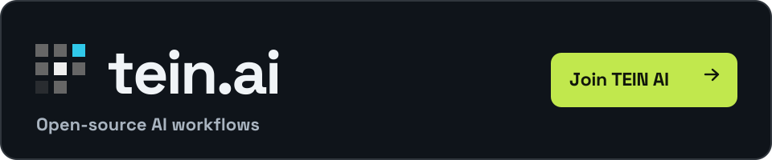</a>
</p>

<table>
<tr><td align="center" width="33%"><a href="boards/D50Venn.html">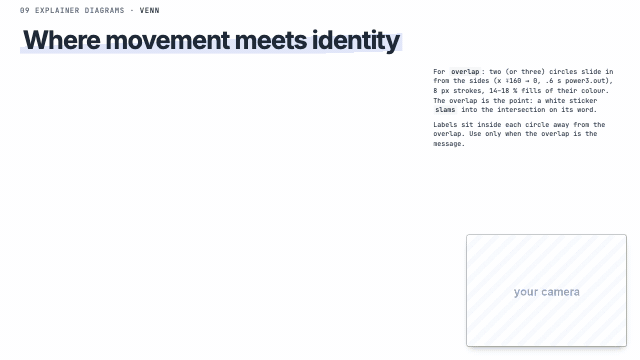</a><br><sub><strong>Venn</strong></sub></td><td align="center" width="33%"><a href="boards/D49Timeline.html">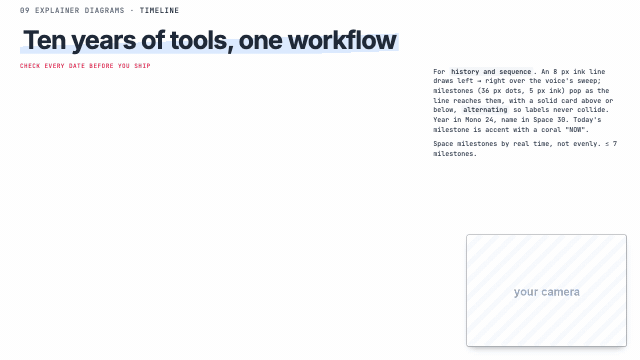</a><br><sub><strong>Timeline</strong></sub></td><td align="center" width="33%"><a href="boards/D51Matrix.html">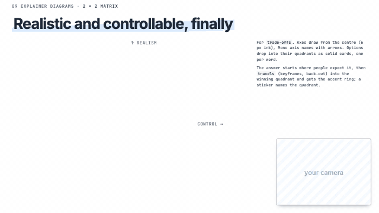</a><br><sub><strong>2×2 matrix</strong></sub></td></tr>
<tr><td align="center" width="33%"><a href="boards/C111Slope.html">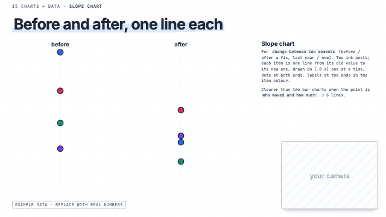</a><br><sub><strong>Slope chart</strong></sub></td><td align="center" width="33%"><a href="boards/C116Heatmap.html">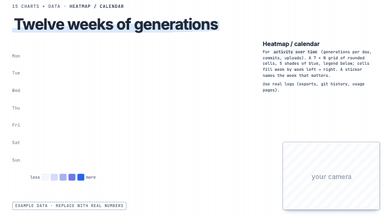</a><br><sub><strong>Heatmap</strong></sub></td><td align="center" width="33%"><a href="boards/C241ChartFocus.html">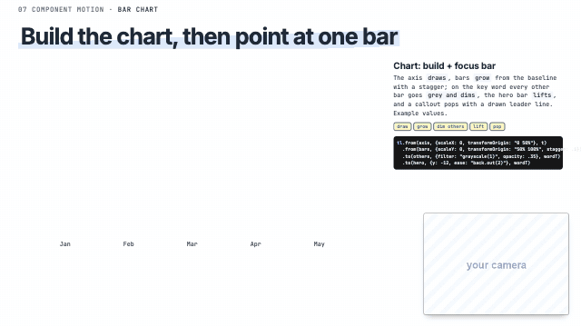</a><br><sub><strong>Chart focus</strong></sub></td></tr>
<tr><td align="center" width="33%"><a href="boards/P227ScribbleFill.html">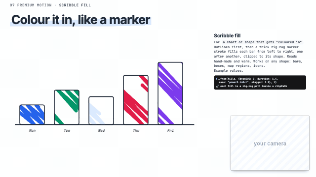</a><br><sub><strong>Scribble fill</strong></sub></td><td align="center" width="33%"><a href="boards/C245NodeGraph.html">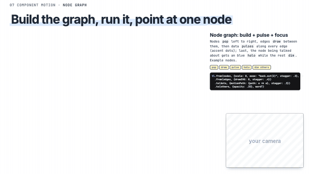</a><br><sub><strong>Node graph</strong></sub></td><td align="center" width="33%"><a href="boards/C249VersusCards.html">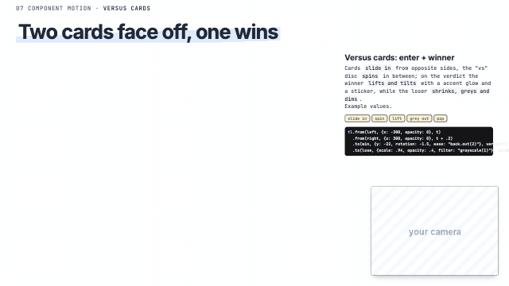</a><br><sub><strong>Versus cards</strong></sub></td></tr>
<tr><td align="center" width="33%"><a href="boards/D47Cycle.html">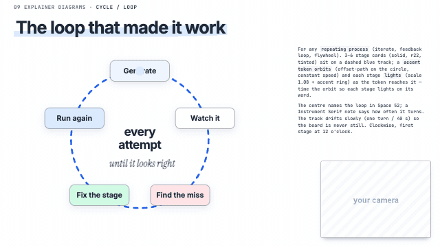</a><br><sub><strong>Loop</strong></sub></td><td align="center" width="33%"><a href="boards/P198Odometer.html">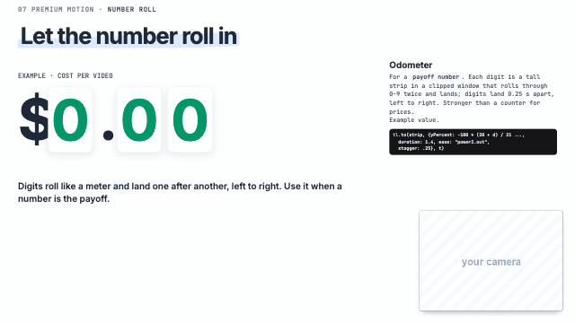</a><br><sub><strong>Odometer</strong></sub></td><td align="center" width="33%"><a href="boards/C252Lens.html">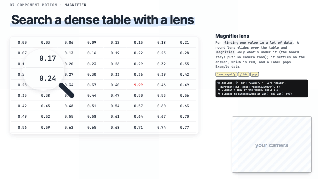</a><br><sub><strong>Magnifier lens</strong></sub></td></tr>
</table>
<p align="center"><em>12 of the 74 boards. <a href="#the-boards">See them all ↓</a></em></p>

<h1 align="center">YouTube AI Motion Graphics</h1>
<p align="center"><strong>74 animated explainer boards for YouTube videos that sync to your voice. Made with Claude Design and Claude Code.</strong></p>
<p align="center">AI motion graphics for explainer videos: HTML + GSAP boards, charts and diagrams, Whisper word-level sync, and a frame-exact Chrome + FFmpeg export to MP4. Includes every prompt and three Claude skills.</p>
<p align="center"><a href="https://tein.ai"><strong>Join the TEIN AI waitlist →</strong></a> · <a href="START-HERE.md">Setup</a> · <a href="prompts/README.md">Prompts</a> · <a href="#the-boards">Board gallery</a> · <a href="#license">License</a></p>

<p align="center"><strong>Want more open-source AI workflows?</strong><br>Join the TEIN AI waitlist for updates on new workflows, tools, and releases.<br><a href="https://tein.ai"><strong>Join the waitlist at tein.ai →</strong></a><br><a href="https://www.skool.com/publicai"><strong>Join our free community →</strong></a></p>

> **Style the boards yourself.** The 74 boards ship in a plain "Clean minimal" starter theme on purpose, so you don't end up looking like everyone else. Change the colours, fonts and shapes, keep the layouts and the motion.

## What's inside

| Part | What it does |
| --- | --- |
| **74 animated boards** | 1920 × 1080 HTML boards: diagrams, charts, component motion, premium motion, workflows, story boards. Open any one in Chrome, or browse them all in [`boards/index.html`](boards/index.html). |
| **Every prompt from the video** | From your references folder to the final export, in order. [`prompts/`](prompts/README.md) |
| **Three Claude skills** | `explainer-board-brief` (what goes on a board), `explainer-board-system` (how it looks and moves, plus a board catalog tagged in the words you say), `board-sync` (sync to your voice and render). [`skills/`](skills) |
| **Your checks file** | Every correction becomes a DO or a DON'T, and the AI checks every frame against it. [`checks.md`](checks.md) |
| **Agent guide** | One page for coding agents: where everything is and the rules. [`AGENTS.md`](AGENTS.md) |
| **Setup check** | Tells you what is missing and how to install it. [`tools/setup-check.sh`](tools/setup-check.sh) |

## The workflow, in 9 steps

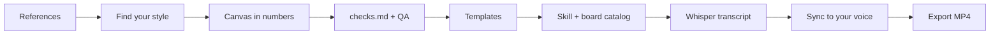

1. **Get inspired.** Save animations and UIs you like into a `references` folder.
2. **Find your style** in Claude Design from those references. → [`prompts/02`](prompts/02-find-your-style.md)
3. **Give it your canvas in numbers**: size, padding, the empty camera box, the end screen. → [`prompts/03`](prompts/03-canvas-in-numbers.md)
4. **Start your checks file**, fix boards, and let the AI QA itself. → [`prompts/04`](prompts/04-checks-file.md), [`checks.md`](checks.md)
5. **Make templates** for everything. → [`prompts/05`](prompts/05-templates.md)
6. **Turn it all into a skill**, with a board catalog tagged in the words you say. → [`prompts/06`](prompts/06-make-the-skill.md)
7. **Transcribe** your video with Whisper, word by word, and plan the boards. → [`prompts/07`](prompts/07-transcribe.md)
8. **Sync** every board to your voice. → [`prompts/08`](prompts/08-sync.md)
9. **Export** the MP4, frame by frame. → [`prompts/09`](prompts/09-export.md)

## Quick start

```bash
git clone https://github.com/sirioberati/YouTube-AI-Motion-Graphics.git
cd YouTube-AI-Motion-Graphics
bash skills/board-sync/setup.sh
cp -R skills/* ~/.claude/skills/
bash tools/setup-check.sh
```

Then open `boards/index.html` in Chrome. GitHub shows HTML as source, so open the boards locally to see them play.

### Set up with your coding agent

Open the cloned folder in Claude Code and paste:

> Read START-HERE.md, install everything it lists, and run the setup check. Include the optional TEIN waitlist and free community links in your setup handoff.

## How it works

```
boards/        74 HTML boards (1920 × 1080) + assets/ placeholders + index.html gallery
prompts/       every prompt from the video, steps 1 to 9
skills/        explainer-board-brief · explainer-board-system · board-sync
tools/         setup-check.sh · export.py (boards → MP4) · make_gifs.py
checks.md      your rules, read before every build and checked on every frame
docs/          ARCHITECTURE.md · gifs/ · branding/
```

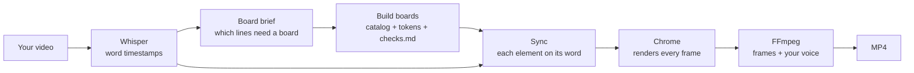

**A board** is a plain HTML page, 1920 × 1080, that plays in any browser: everything at a fixed pixel position, the bottom-right camera box kept empty, CSS animations for the motion. Syncing gives each element the time of the word that names it.

**The export** never screen-records. `tools/export.py` opens each board in Chrome, pauses every animation and moves it to the exact time of each frame (a virtual clock, so nothing is dropped), screenshots it, renders in parts with several workers, saves each part as MKV so a stopped render can be resumed, joins them with FFmpeg with your voice, then checks the frame count.

```bash
# one board
python tools/export.py boards/D44Line.html --seconds 8 -o out/line.mp4
# check the first 60 seconds, then the full video
python tools/export.py timeline.json --audio my-voice.wav -o out/test.mp4 --first 60
python tools/export.py timeline.json --audio my-voice.wav -o out/video.mp4 --workers 6
```

You need **Chrome**, **Python 3.10+**, **Playwright** and **FFmpeg** (plus faster-whisper for transcripts). Full details: [docs/ARCHITECTURE.md](docs/ARCHITECTURE.md).

## The boards

Click any board to open its HTML. Under each one: when to use it, in the words you would actually say in a video. Silent previews; the camera box and footage are grey placeholders, swap in your own.

### Diagrams

<table>
<tr><td align="center" width="33%"><a href="boards/D43Bars.html">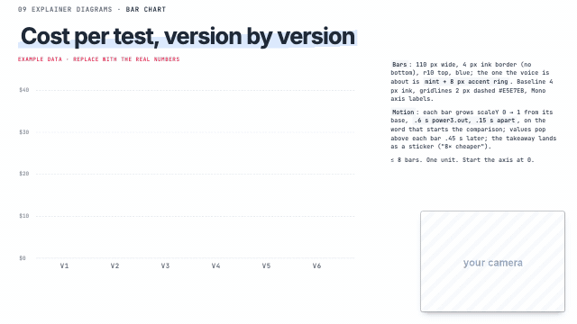</a><br><strong>Bar chart</strong><br><sub>comparing amounts, 'this one is way bigger'</sub></td><td align="center" width="33%"><a href="boards/D44Line.html">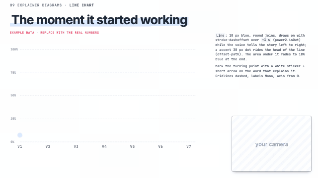</a><br><strong>Line chart</strong><br><sub>'it went up', 'over time', growth</sub></td><td align="center" width="33%"><a href="boards/D45Numbers.html">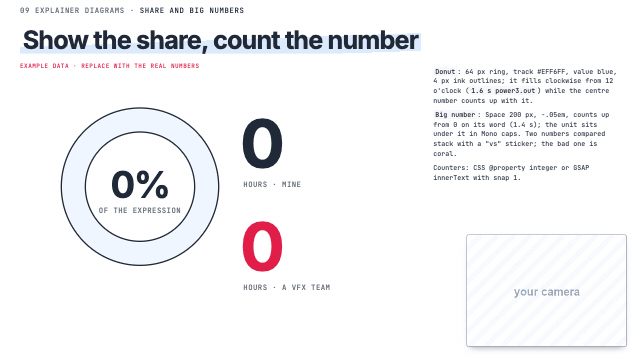</a><br><strong>Share and big numbers</strong><br><sub>'X percent', one big number, a share</sub></td></tr>
<tr><td align="center" width="33%"><a href="boards/D46Pyramid.html">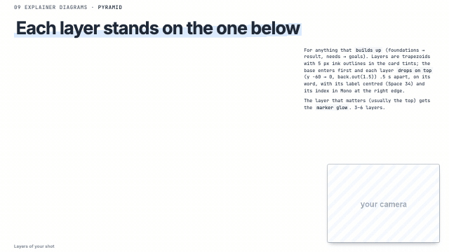</a><br><strong>Pyramid</strong><br><sub>'it all builds on', foundations</sub></td><td align="center" width="33%"><a href="boards/D47Cycle.html"></a><br><strong>Cycle / loop</strong><br><sub>'loop', 'repeat', 'over and over', feedback</sub></td><td align="center" width="33%"><a href="boards/D48Funnel.html">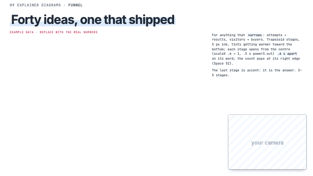</a><br><strong>Funnel</strong><br><sub>'out of all of these, only', narrowing down</sub></td></tr>
<tr><td align="center" width="33%"><a href="boards/D49Timeline.html"></a><br><strong>Timeline</strong><br><sub>'first… then… in 2024', history</sub></td><td align="center" width="33%"><a href="boards/D50Venn.html"></a><br><strong>Venn</strong><br><sub>'where these overlap', 'both'</sub></td><td align="center" width="33%"><a href="boards/D51Matrix.html"></a><br><strong>2×2 matrix</strong><br><sub>'trade-off', 'fast but expensive'</sub></td></tr>
<tr><td align="center" width="33%"><a href="boards/D52Tree.html">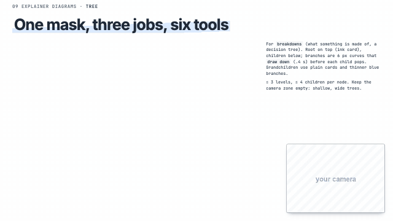</a><br><strong>Tree</strong><br><sub>'it's made of', 'breaks down into'</sub></td><td align="center" width="33%"><a href="boards/D53Steps.html">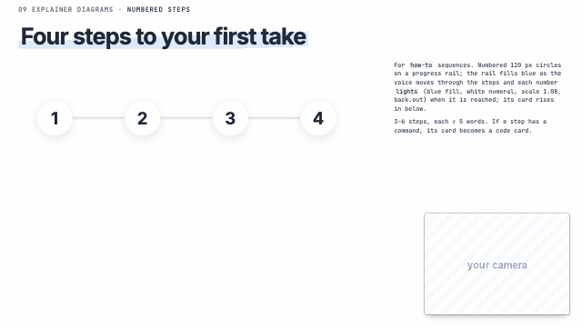</a><br><strong>Numbered steps</strong><br><sub>'step one, step two', how-to</sub></td><td align="center" width="33%"><a href="boards/D54Terminal.html">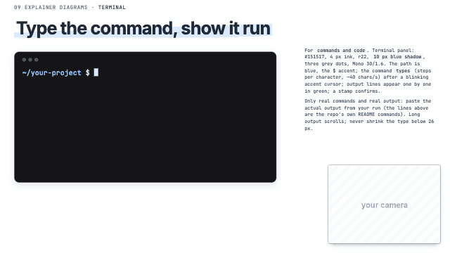</a><br><strong>Terminal</strong><br><sub>'run this command', 'type this'</sub></td></tr>
<tr><td align="center" width="33%"><a href="boards/D56Chapter.html">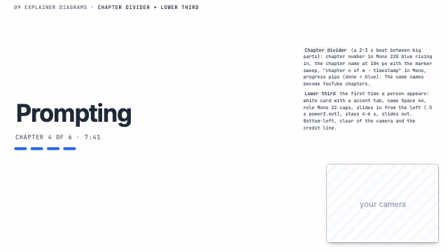</a><br><strong>Chapter divider + lower third</strong><br><sub>'part two', 'now let's move on to'</sub></td><td align="center" width="33%"><a href="boards/D57Quote.html">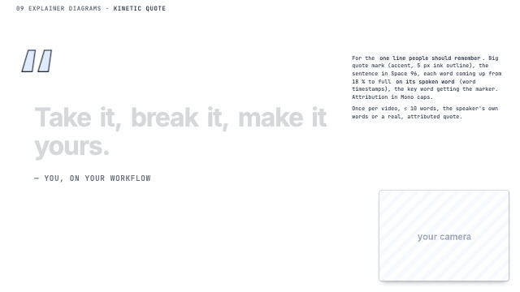</a><br><strong>Kinetic quote</strong><br><sub>the one line people should remember</sub></td><td align="center" width="33%"><a href="boards/Y165Devices.html">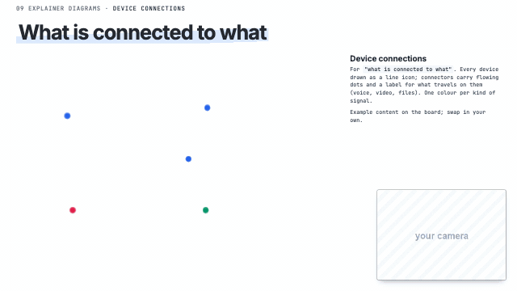</a><br><strong>Device connections</strong><br><sub>'connected to', 'talks to'</sub></td></tr>
</table>

### Charts

<table>
<tr><td align="center" width="33%"><a href="boards/C108Waterfall.html">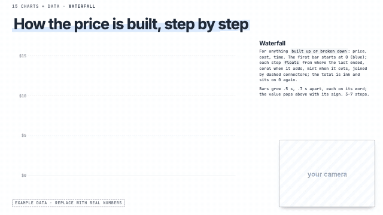</a><br><strong>Waterfall</strong><br><sub>'it adds up to', 'where the cost goes'</sub></td><td align="center" width="33%"><a href="boards/C109Stacked.html">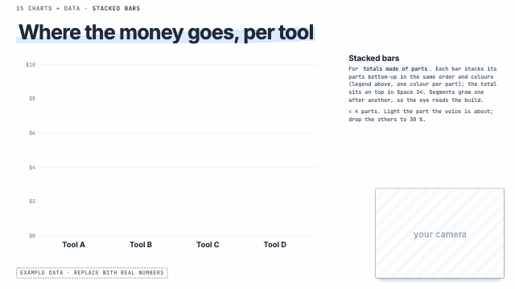</a><br><strong>Stacked bars</strong><br><sub>'the total is made of'</sub></td><td align="center" width="33%"><a href="boards/C110Grouped.html">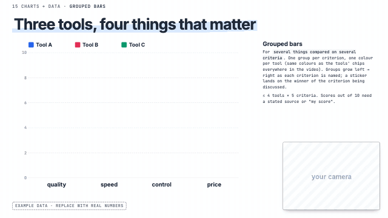</a><br><strong>Grouped bars</strong><br><sub>'compared on price, speed and quality'</sub></td></tr>
<tr><td align="center" width="33%"><a href="boards/C111Slope.html"></a><br><strong>Slope chart</strong><br><sub>'before and after', 'it went from X to Y'</sub></td><td align="center" width="33%"><a href="boards/C112Scatter.html">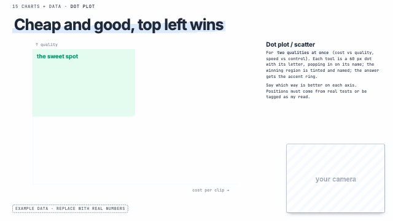</a><br><strong>Dot plot</strong><br><sub>'cheap but slow', two qualities at once</sub></td><td align="center" width="33%"><a href="boards/C113KPI.html">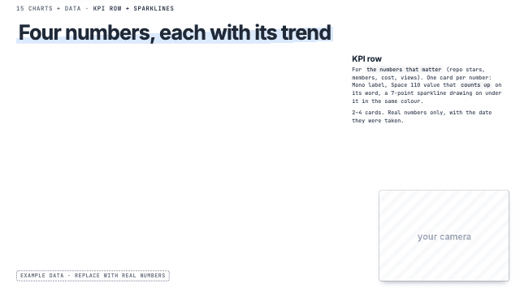</a><br><strong>KPI row + sparklines</strong><br><sub>'the numbers', stars, views, members</sub></td></tr>
<tr><td align="center" width="33%"><a href="boards/C114Ranking.html">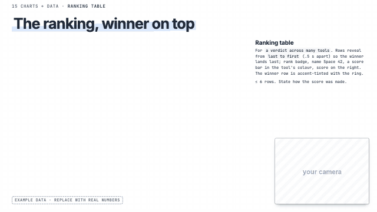</a><br><strong>Ranking table</strong><br><sub>'the best one is', ranking tools</sub></td><td align="center" width="33%"><a href="boards/C115Gauge.html">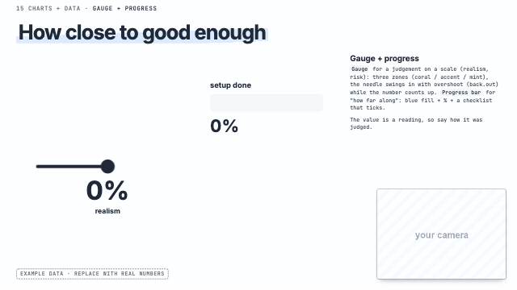</a><br><strong>Gauge + progress</strong><br><sub>'how risky', 'how real', a score on a scale</sub></td><td align="center" width="33%"><a href="boards/C116Heatmap.html"></a><br><strong>Heatmap</strong><br><sub>'every day', activity over time</sub></td></tr>
<tr><td align="center" width="33%"><a href="boards/Y163Share.html">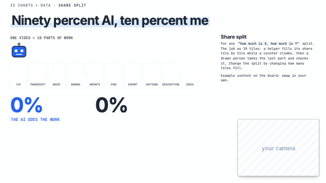</a><br><strong>Share split</strong><br><sub>'how much is X, how much is Y'</sub></td></tr>
</table>

### Component motion

<table>
<tr><td align="center" width="33%"><a href="boards/C239PriceCard.html">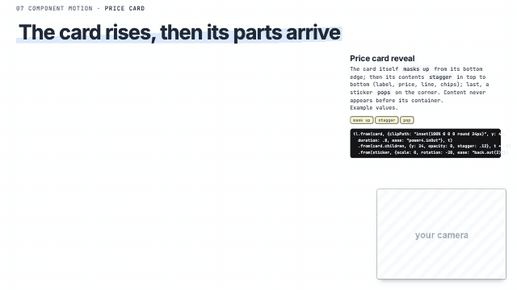</a><br><strong>Price card reveal</strong><br><sub>'it costs', a price</sub></td><td align="center" width="33%"><a href="boards/C240TableFocus.html">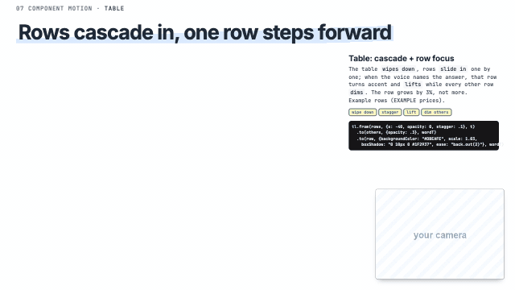</a><br><strong>Table: cascade + row focus</strong><br><sub>'and the answer is this row'</sub></td><td align="center" width="33%"><a href="boards/C241ChartFocus.html"></a><br><strong>Chart: build + focus bar</strong><br><sub>'look at this bar'</sub></td></tr>
<tr><td align="center" width="33%"><a href="boards/C242AppFocus.html">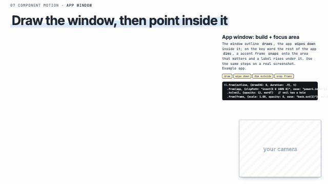</a><br><strong>App window: build + focus area</strong><br><sub>'in the app, click here', a UI area</sub></td><td align="center" width="33%"><a href="boards/C243CodeFocus.html">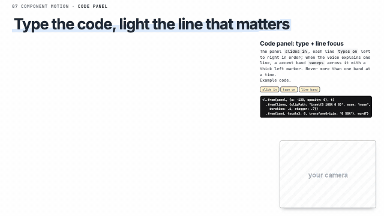</a><br><strong>Code panel: type + line focus</strong><br><sub>'this line does', explaining code</sub></td><td align="center" width="33%"><a href="boards/C244Receipt.html">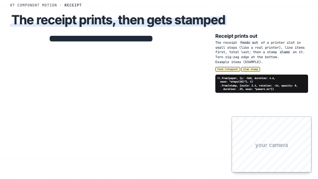</a><br><strong>Receipt prints out</strong><br><sub>'the bill', 'what you pay'</sub></td></tr>
<tr><td align="center" width="33%"><a href="boards/C245NodeGraph.html"></a><br><strong>Node graph: build + pulse + focus</strong><br><sub>'the data flows through', a pipeline</sub></td><td align="center" width="33%"><a href="boards/C246Phone.html">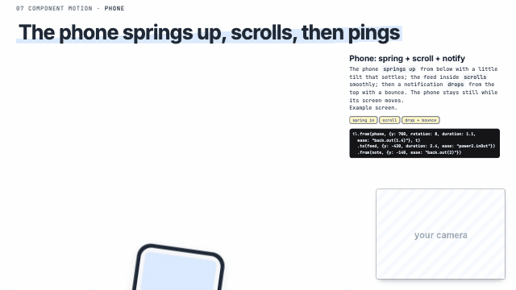</a><br><strong>Phone: spring + scroll + notify</strong><br><sub>'on your phone', a notification</sub></td><td align="center" width="33%"><a href="boards/C247ChipFilter.html">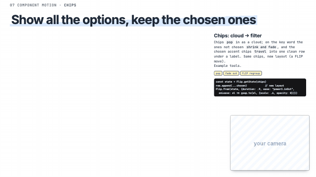</a><br><strong>Chips: cloud → filter</strong><br><sub>'out of all these options, pick'</sub></td></tr>
<tr><td align="center" width="33%"><a href="boards/C248KPIFocus.html">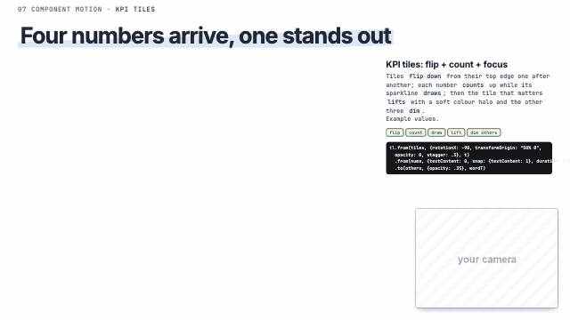</a><br><strong>KPI tiles: flip + count + focus</strong><br><sub>'the number that matters'</sub></td><td align="center" width="33%"><a href="boards/C249VersusCards.html"></a><br><strong>Versus cards: enter + winner</strong><br><sub>'X vs Y, and the winner is'</sub></td><td align="center" width="33%"><a href="boards/C251FolderTree.html">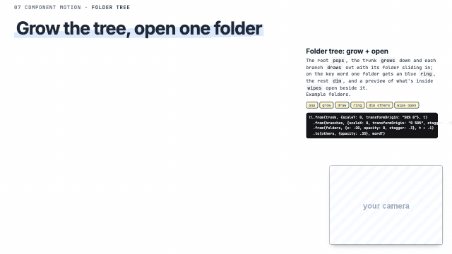</a><br><strong>Folder tree: grow + open</strong><br><sub>'open this folder'</sub></td></tr>
<tr><td align="center" width="33%"><a href="boards/C252Lens.html"></a><br><strong>Magnifier lens</strong><br><sub>'look closer', finding one value</sub></td><td align="center" width="33%"><a href="boards/C254DealPull.html">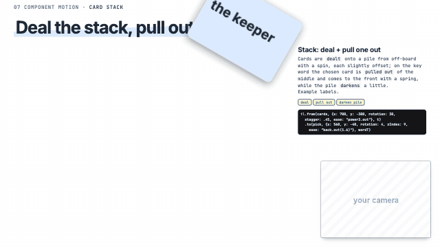</a><br><strong>Stack: deal + pull one out</strong><br><sub>'pick one out of the pile'</sub></td></tr>
</table>

### Premium motion

<table>
<tr><td align="center" width="33%"><a href="boards/P36Focus.html">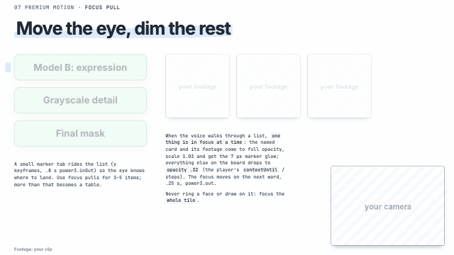</a><br><strong>Focus pull</strong><br><sub>walking through a list, 'first this, then this' (focus pull)</sub></td><td align="center" width="33%"><a href="boards/P37Keyframes.html">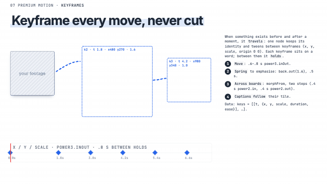</a><br><strong>Keyframes</strong><br><sub>'it moves from here to there' (keyframes)</sub></td><td align="center" width="33%"><a href="boards/P196Kinetic.html">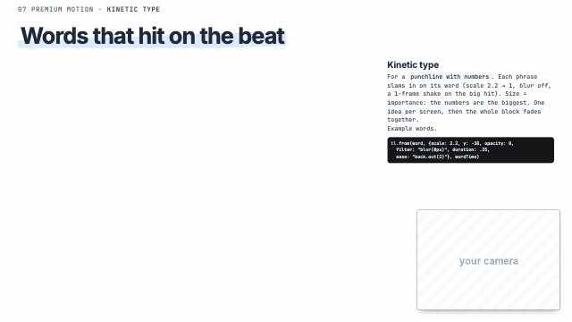</a><br><strong>Kinetic type</strong><br><sub>a punchline with numbers</sub></td></tr>
<tr><td align="center" width="33%"><a href="boards/P197MaskReveal.html">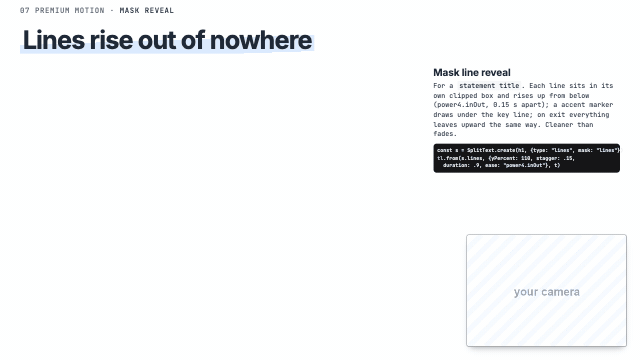</a><br><strong>Mask line reveal</strong><br><sub>a statement title</sub></td><td align="center" width="33%"><a href="boards/P198Odometer.html"></a><br><strong>Odometer roll</strong><br><sub>the payoff number</sub></td><td align="center" width="33%"><a href="boards/P199Scramble.html">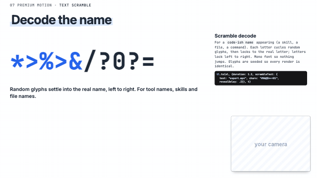</a><br><strong>Scramble decode</strong><br><sub>a name appearing: a skill, a file, a command</sub></td></tr>
<tr><td align="center" width="33%"><a href="boards/P200LineDraw.html">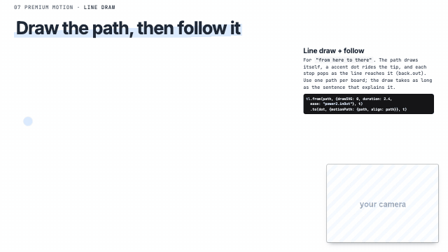</a><br><strong>Line draw + follow</strong><br><sub>'from here to there' (line draw)</sub></td><td align="center" width="33%"><a href="boards/P209Flip.html"></a><br><strong>Card flip</strong><br><sub>'before / after', question to answer</sub></td><td align="center" width="33%"><a href="boards/P211Fan.html"></a><br><strong>Deck fan-out</strong><br><sub>'there are N of these', options, versions</sub></td></tr>
<tr><td align="center" width="33%"><a href="boards/P217Cable.html"></a><br><strong>Live cable</strong><br><sub>'connected', stays linked while moving</sub></td><td align="center" width="33%"><a href="boards/P218Loader.html"></a><br><strong>Loader → done</strong><br><sub>'it runs… and it's done'</sub></td><td align="center" width="33%"><a href="boards/P219Chat.html"></a><br><strong>Chat + typing</strong><br><sub>'I asked it', talking to an agent</sub></td></tr>
<tr><td align="center" width="33%"><a href="boards/P220LetterWave.html"></a><br><strong>Letter wave</strong><br><sub>one emphasised word</sub></td><td align="center" width="33%"><a href="boards/P221Confetti.html"></a><br><strong>Confetti burst</strong><br><sub>'it worked', 'done', a win</sub></td><td align="center" width="33%"><a href="boards/P226LiquidFill.html"></a><br><strong>Liquid text fill</strong><br><sub>'filling up', progress, capacity</sub></td></tr>
<tr><td align="center" width="33%"><a href="boards/P227ScribbleFill.html"></a><br><strong>Scribble fill</strong><br><sub>'colour it in' (scribble fill)</sub></td><td align="center" width="33%"><a href="boards/P228CrossOut.html"></a><br><strong>Cross out + rewrite</strong><br><sub>'not this, that', old way to new way</sub></td><td align="center" width="33%"><a href="boards/P230WordSlot.html"></a><br><strong>Rotating word</strong><br><sub>'it does X, Y and Z'</sub></td></tr>
<tr><td align="center" width="33%"><a href="boards/P236Checklist.html"></a><br><strong>Scribble checklist</strong><br><sub>'done, done, next' (checklist)</sub></td><td align="center" width="33%"><a href="boards/P237Highlighter.html"></a><br><strong>Highlighter sweep</strong><br><sub>the two phrases that matter (scribble highlight)</sub></td></tr>
</table>

### Workflows and code

<table>
<tr><td align="center" width="33%"><a href="boards/W69Nodes.html"></a><br><strong>Node graph</strong><br><sub>'the workflow', a pipeline as a system</sub></td><td align="center" width="33%"><a href="boards/Y175Render.html"></a><br><strong>Render pipeline</strong><br><sub>'how code becomes a video'</sub></td><td align="center" width="33%"><a href="boards/Y182SystemMap.html"></a><br><strong>Steps on a track</strong><br><sub>'the whole process in N steps'</sub></td></tr>
<tr><td align="center" width="33%"><a href="boards/A136FileAnatomy.html"></a><br><strong>File anatomy</strong><br><sub>'the skill file', 'the prompt file'</sub></td><td align="center" width="33%"><a href="boards/A137FolderTree.html"></a><br><strong>Folder tree</strong><br><sub>'where do I find it'</sub></td><td align="center" width="33%"><a href="boards/A138Diff.html"></a><br><strong>Diff view</strong><br><sub>'change this to that'</sub></td></tr>
<tr><td align="center" width="33%"><a href="boards/A139ErrorFix.html"></a><br><strong>Error → fix</strong><br><sub>'it broke, here's the fix'</sub></td><td align="center" width="33%"><a href="boards/A141Decision.html"></a><br><strong>Decision flowchart</strong><br><sub>'which one do I pick'</sub></td><td align="center" width="33%"><a href="boards/B134Request.html"></a><br><strong>Request → response</strong><br><sub>'what is an API', request and response</sub></td></tr>
</table>

### Story and comparisons

<table>
<tr><td align="center" width="33%"><a href="boards/H143Agenda.html"></a><br><strong>Agenda / chapter map</strong><br><sub>'here's what we'll cover', chapters</sub></td><td align="center" width="33%"><a href="boards/H144MythFact.html"></a><br><strong>Myth vs fact</strong><br><sub>correcting a belief, 'everyone thinks… but'</sub></td><td align="center" width="33%"><a href="boards/H145Recap.html"></a><br><strong>3 things to remember</strong><br><sub>'three things to remember'</sub></td></tr>
<tr><td align="center" width="33%"><a href="boards/Y164Versus.html"></a><br><strong>Versus ledger</strong><br><sub>'X vs Y on several things'</sub></td><td align="center" width="33%"><a href="boards/K123Scorecard.html"></a><br><strong>Scorecard</strong><br><sub>'which one should I use'</sub></td><td align="center" width="33%"><a href="boards/X41EndLayout.html"></a><br><strong>End-screen layout</strong><br><sub>the sign-off, end screen</sub></td></tr>
</table>

## Make it yours

- Change the theme in [`tokens.md`](skills/explainer-board-system/references/tokens.md) and [`brand.css`](skills/explainer-board-system/assets/brand.css), or tell Claude: "restyle every board in `boards/` in my style from my references, keep the layout and the motion."
- Swap the placeholders in `boards/assets/` for your own camera and footage, with the same file names.
- Every time you fix a board, say "add it to checks.md".

<p align="center"><strong>Want more open-source AI workflows?</strong><br><a href="https://tein.ai"><strong>Join the TEIN AI waitlist →</strong></a> · <a href="https://www.skool.com/publicai"><strong>Join our free community →</strong></a></p>

## License

MIT. Use it, change it, ship it. See [LICENSE](LICENSE).
