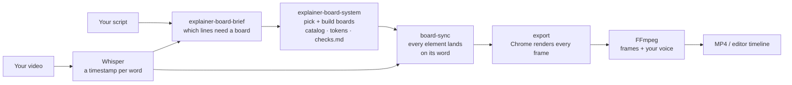

# Architecture

How the repo is laid out, how a board works, and how boards become an MP4.

## What's in the folder

```
YouTube-AI-Motion-Graphics/
├── README.md              start here: gallery, workflow, quick start
├── START-HERE.md          install guide (the one your agent reads)
├── checks.md              your rules: every correction becomes a DO or a DON'T
├── LICENSE                MIT
├── boards/                74 animated boards, one HTML file each (1920 × 1080)
│   ├── index.html         live gallery of every board
│   └── assets/            grey placeholders for your camera and footage (same names: swap in your own)
├── prompts/               every prompt from the video, steps 1 to 9
├── skills/
│   ├── explainer-board-brief/    what goes on each board (reads your script line by line)
│   ├── explainer-board-system/   how boards look and move + the board catalog
│   └── board-sync/               syncs boards to your voice, renders, writes an editor timeline
├── tools/
│   ├── setup-check.sh     checks everything is installed
│   ├── export.py          boards → MP4, frame by frame in Chrome, joined with FFmpeg
│   └── make_gifs.py       boards → the GIF previews in docs/gifs
└── docs/
    ├── ARCHITECTURE.md    this file
    ├── gifs/              one silent GIF per board
    └── branding/          the TEIN banner
```

## The pipeline



| Step | Tool | In | Out |
|---|---|---|---|
| Transcribe | Whisper (`faster-whisper`, in board-sync) | your video or WAV | words with start and end times |
| Plan | `explainer-board-brief` skill | script + transcript | a brief: one idea per board, the exact words, the board type |
| Build | `explainer-board-system` skill (Claude Design or Claude Code) | brief + board catalog + `checks.md` | one HTML file per board |
| Sync | `board-sync` skill | boards + transcript | boards whose elements appear on the word that names them |
| QA | Claude + Chrome screenshots | every frame | a list of misses, fixed, each new kind added to `checks.md` |
| Export | `tools/export.py` or board-sync's renderer | boards + timeline + your voice | the MP4 |

## How a board works

A board is a plain HTML page, 1920 × 1080, that opens in any browser. Nothing to build or install.

- **Layout:** everything sits at a fixed pixel position on the 1920 × 1080 canvas. The bottom-right 480 × 336 box is kept empty for your camera, with 60 px padding on every side.
- **Look:** fonts (Inter, JetBrains Mono, Instrument Serif) load from Google Fonts. Colours, borders and shadows come from the tokens in `skills/explainer-board-system/references/tokens.md`.
- **Motion:** CSS animations and keyframes. Each starter board loops (most every 8 to 12 seconds) so you can watch it on its own.
- **Sync:** when you sync to your voice, each element gets the time of the word that names it, so it lands when you say it. Nothing should sit still for more than 5 seconds.
- **Assets:** images and clips live in `boards/assets/`. Replace the placeholders with your own files, same names.

Open one in Chrome to watch it. GitHub shows the HTML source, not the animation, so run boards locally.

## How the export works (and why it's built this way)

Don't ask an AI to "export the HTML to MP4": a screen recording drops frames and loses the design. `tools/export.py` does this instead:

1. **Chrome opens each board** (headless, through Playwright) at exactly 1920 × 1080.
2. **A virtual clock.** For every frame, every animation on the page is paused and moved to that frame's exact time (`document.getAnimations()`, GSAP's timeline, `window.seek(t)` if the board has one, and any videos). Then Chrome takes a screenshot. It never runs in real time, so it never drops a frame, however slow the machine.
3. **Parts and workers.** The frames are split into parts (20 s each by default) and rendered by several workers at once.
4. **MKV, not MP4,** for each part: if a render stops halfway, an MKV can still be opened, and finished parts are kept when you run it again.
5. **FFmpeg joins** the parts without re-encoding and adds your voice.
6. **Frame check.** The frame count of the final video is checked against the length it should have.

```bash
# one board, 8 seconds
python tools/export.py boards/D44Line.html --seconds 8 -o out/line.mp4

# a whole video from a timeline, with your voice: render the first 60 s first and check it
python tools/export.py timeline.json --audio my-voice.wav -o out/test.mp4 --first 60
python tools/export.py timeline.json --audio my-voice.wav -o out/video.mp4 --workers 6
```

`timeline.json` lists which board is on screen when, in seconds on your audio:

```json
[
  {"board": "boards/D44Line.html",   "start": 0.0, "end": 7.4},
  {"board": "boards/C111Slope.html", "start": 7.4, "end": 15.0}
]
```

Every frame's position is rounded once on the whole timeline, so boards never drift against your voice. For a full synced edit with an editor timeline (DaVinci Resolve, Premiere), use the `board-sync` skill. It runs the same frame-by-frame render on its own synced scenes.

## Requirements

| Need | Why | Install |
|---|---|---|
| Chrome | opens and renders the boards | google.com/chrome |
| Python 3.10+ | runs the tools | python.org |
| Playwright | drives Chrome frame by frame | `pip install playwright` then `python -m playwright install chromium` (or pass `--chrome` to use your installed Chrome) |
| FFmpeg | joins frames, adds audio | macOS `brew install ffmpeg` · Windows `winget install ffmpeg` |
| faster-whisper | word timestamps | in `skills/board-sync/requirements.txt` |
| Claude Code | runs the skills and prompts | claude.com/claude-code |

`bash skills/board-sync/setup.sh` installs the Python side. `bash tools/setup-check.sh` checks everything.
